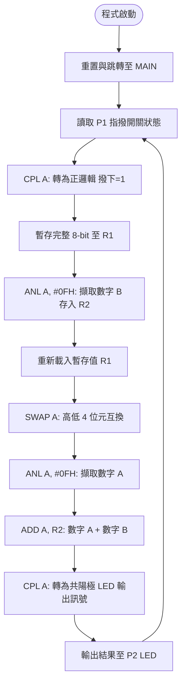

# 8051 4-bit 迷你二進位加法器 (DIP-Switch Binary Adder)

本專案使用 8051 組合語言（Assembly 8051 / Keil A51）實作一個 **4-bit 迷你二進位加法器**。透過讀取 8 位元的指撥開關（DIP Switch）輸入，將其拆解為兩個 4 位元的二進位數值進行相加，並將運算結果即時顯示於 8 位元的 LED 上。

---

## 📌 功能概述

1. **雙 4 位元數值輸入**：
   - 透過單一 8-bit 指撥開關（連接至 **Port 1 / P1**）同時輸入兩個數字：
     - **數字 A（高 4 位元，P1.7 ~ P1.4）**：範圍 `0 ~ 15` (0000B ~ 1111B)
     - **數字 B（低 4 位元，P1.3 ~ P1.0）**：範圍 `0 ~ 15` (0000B ~ 1111B)
2. **硬體邏輯反相轉換**：
   - 指撥開關通常在撥下（ON）時接地輸出低電位 `0`，未撥（OFF）為高電位 `1`。
   - 程式透過 `CPL A` 將讀入的電位反相，轉換為正邏輯（撥下為 `1`，未撥為 `0`），以利進行數學運算。
3. **高/低 4 位元數值拆解**：
   - 利用 `ANL`（邏輯 AND）遮罩擷取低 4 位元作為**數字 B**。
   - 利用 `SWAP A`（高低 4 位互換）搭配 `ANL` 擷取高 4 位元作為**數字 A**。
4. **二進位加法運算**：
   - 使用 `ADD A, R2` 指令計算 `數字 A + 數字 B`（最高和可達 30，即 `11110B`，小於 8-bit 上限 255）。
5. **LED 狀態輸出顯示**：
   - 將運算結果再次反相（`CPL A`），配合共陽極（Active Low）LED 顯示特性，輸出至 **Port 2 / P2** 即時亮燈。
6. **動態即時偵測**：
   - 採用無窮迴圈 `LOOP`，持續動態輪詢指撥開關狀態並即時刷新 LED 顯示結果。

---

## 🔌 硬體配置與腳位對應

| 8051 腳位 | 連接設備 | 邏輯說明 |
| :--- | :--- | :--- |
| **P1.7 ~ P1.4** | 指撥開關 高 4 位 (DIP SW 8~5) | **數字 A** (0~15) 輸入端 |
| **P1.3 ~ P1.0** | 指撥開關 低 4 位 (DIP SW 4~1) | **數字 B** (0~15) 輸入端 |
| **P2.7 ~ P2.0** | 8 顆 LED (共陽極 Active Low) | **加法運算結果 (Sum)** 輸出顯示 |

---

## 🧠 程式邏輯與流程

---

## 📂 專案檔案結構

- [DIP-switch.a51](file:///g:/code/Program/Assembly/NKUST_1151_0886_Embedded_System/02_DIP-switch/DIP-switch.a51)：8051 組合語言主程式原始碼。
- [DIP-switch.hex](file:///g:/code/Program/Assembly/NKUST_1151_0886_Embedded_System/02_DIP-switch/DIP-switch.hex)：編譯生成的 Intel HEX 燒錄/模擬檔案。
- [DIP-switch.lst](file:///g:/code/Program/Assembly/NKUST_1151_0886_Embedded_System/02_DIP-switch/DIP-switch.lst)：組譯過程產生的清單檔案（Listing file）。
- `pdsprj/`：Proteus 模擬專案目錄。
